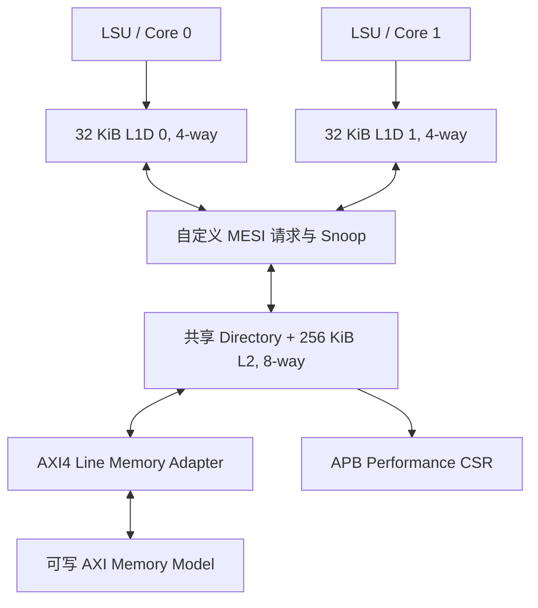

# NutShell MESI Cache Subsystem

[](https://github.com/cwu766485-ctrl/open_verif_learning/actions/workflows/nutshell-cache-dv.yml)

这是一个面向开源数字 IC 验证学习的双核 MESI Cache 项目。它保留原有的 NutShell 单 L1 DCache 回归，并增加一套独立的双 L1、一致性 Directory、共享 L2、AXI4 内存接口和 APB 性能 CSR 子系统。v1.0.1 为冻结候选；正式固定发布版本的验收条件是当前候选分支上的 Legacy 与 Coherence 两个 CI Job 均通过。PPA、物理 SRAM 映射和芯片级时序不在交付范围内。

## 架构



- 两个私有 L1D：每核 32 KiB、4-way、64-byte line。
- 共享 inclusive L2 与 Directory：256 KiB、8-way；Directory 与 refill 分别有四个事务上下文/MSHR。
- AXI4 adapter 每个读写方向最多支持四笔活动事务，按 ID 路由响应；AXI 顶层已接入可读写 burst memory model。
- 每个 L1 控制器仍为 blocking，L2 fill、Grant、Snoop 和 dirty writeback 仍共享部分数据资源。因此，adapter 的四笔 outstanding 不代表 Cache 可同时处理四个 CPU miss。
- APB CSR 暴露 Cache hit/miss、Snoop、dirty writeback 和协议错误统计。项目没有自建 JTAG TAP。

## 验证结果

`cache_coherence` 上的开源验证流程覆盖独立模块、双核子系统、AXI 集成、Python/Toffee scoreboard、覆盖率和组件级 bounded formal。完整结果和边界见[最终验证报告](reports/final/nutshell_cache_verification_report.md)与[测试计划映射](docs/testplan_to_coverage_matrix.md)。

| 项目 | 当前证据 |
| --- | --- |
| Legacy 单 L1 回归 | 46 passed；26 skipped、3 deselected（按现有测试标记） |
| MESI RTL/SV 回归 | 38/38 功能 bins；合并 LCOV 3153/3441 行命中（91.6%，其中产品 RTL 1579/1823） |
| Python/Toffee | 26 passed；功能 bins 38/38、cross bins 12/12；checker fault injection 9/9 |
| 并发压力 | 标准与 dense-set 各 20 seeds × 200 操作；dense-set 修复前 14/20 seeds 失败，修复后 20/20 通过 |
| AXI | adapter Python 3/3；集成 benchmark 五个 seed 通过；R-only、B-only、R+B 三种集成响应反压通过 |
| Formal / RTL mutation | 7 个组件级 bounded formal 目标通过；两项真实 L1 RTL mutation 均被测试检测到 |

Formal 结果是组件级、有界的证据，不是完整 Cache 子系统的无界证明。覆盖率缺口审阅列出 244 条未命中的产品 RTL 行和 44 条 testbench 行；stale Upgrade 与 Snoop ACK→L2 retry 已由独立 Python/Toffee 测试关闭，其他恢复路径仍列在 [v1.1 验证 backlog](docs/releases/v1.1_verification_backlog.md)，未把它们标记为已覆盖。

## 仿真性能样本

下表来自 [Benchmark v4 实测结果](docs/coherence_benchmark_v4_results_2026-10-29.md)，使用双 LSU agent、10 ns 仿真时钟和可配置的 backing-memory model。周期与 bytes/cycle 描述当前 RTL 和 workload，不是实际 CPU 应用性能、物理频率、DRAM 带宽或 PPA。

| 工作负载 | 测量结果 |
| --- | --- |
| Warm L1 read | L1 read hit 100%；平均延迟 2 cycles |
| L1 miss、L2 hit | 64/256 KiB working set：L2 refill hit 100%；平均延迟 22 cycles |
| 512 KiB working set | L1/L2 refill hit 均为 0%；平均延迟 42 cycles；1.455 B/cycle |
| 双核独立 cold miss 相对单核串行 | memory delay 2/20/50/100 cycles 时为 1.451×/1.594×/1.717×/1.812× |
| False sharing A/B | 同 line 33 snoops、0.0684 ops/cycle；分离 line 0 snoops、0.4961 ops/cycle |
| AXI 顶层五 seed 混合 workload（v3） | 0.03383 ops/cycle；模型内存流量 0.75415 B/cycle |

## 快速开始

在 Ubuntu/WSL 仓库目录运行。项目提供本地 Python、Picker、Verilator 与 SymbiYosys 工具环境：

```bash
source scripts/env.sh
make doctor

# 原单 L1 DCache 回归
make gen_dut && make test

# MESI 模块、Formal、Python/Toffee、AXI 与压力回归
make COHERENCE_JOBS=2 coherence_verify

# 单独重跑长随机压力、Benchmark v3 或 Cache-only Benchmark v4
make COHERENCE_JOBS=2 coherence_stress coherence_dense_set_stress
make COHERENCE_JOBS=2 coherence_benchmark_v3
make coherence_benchmark_v4
```

不要在没有 `source scripts/env.sh` 的系统 Python 环境中直接运行 pytest；项目依赖由仓库环境固定。各目标定义见根目录 [`Makefile`](Makefile)、[DV 说明](dv/README.md)和[Formal 说明](formal/README.md)。

## 目录

- `rtl/`：MESI 子系统与 `rtl/legacy_l1/` 中的原单 L1 RTL。
- `dv/`：Python agents、独立 reference model、scoreboard、monitor、coverage 与 fault injection。
- `tests/`：Python/Toffee 测试和 SystemVerilog 模块/集成基线。
- `formal/`：SymbiYosys harness、性质和 mutation 检查。
- `benchmarks/`：固定 workload、baseline、JSON/CSV 性能结果。
- `docs/`、`reports/final/`：规格、验证计划、[真实 Bug 案例](docs/bug_case_studies.md)和可复现的签核材料。

## 设计与验证边界

- 这是 Cache 子系统原型，不包含完整 CPU、ISA fence/acquire-release 验证或 SoC。
- D01 message-passing 用例只验证测试驱动定义的 Store 完成顺序下的一致性可见性，不证明 RVWMO。
- 四个 Directory context/MSHR 与 blocking L1 并存；端到端 CPU miss 并行度受 L1 和共享资源约束。
- 当前没有综合、Fmax、面积、功耗、真实 SRAM macro 映射或 STA 结果；Benchmark 不应解释为 PPA。

### 主要文档

- [MESI 架构与接口](docs/cache.md)
- [验证环境架构](dv/README.md)
- [Benchmark 方法与复现](docs/coherence_benchmark.md)
- [Benchmark v4 指标契约与工作负载](docs/coherence_benchmark_v4_plan.md)
- [Benchmark v4 结果](docs/coherence_benchmark_v4_results_2026-10-29.md)
- [Benchmark v3 结果](docs/coherence_benchmark_v3_results_2026-10-25.md)
- [Testplan-to-Coverage Matrix](docs/testplan_to_coverage_matrix.md)
- [Coverage Gap Review](docs/coherence_coverage_gap_review.md)
- [MESI Bug 案例](docs/bug_case_studies.md)
- [v1.0 冻结清单](docs/releases/v1.0.md)
- [v1.0.1 Release Manifest](docs/releases/v1.0.1.md)
- [归档文档索引](docs/archive/README.md)
- [最终技术与验证报告 PDF](reports/final/nutshell_cache_verification_report.pdf)
